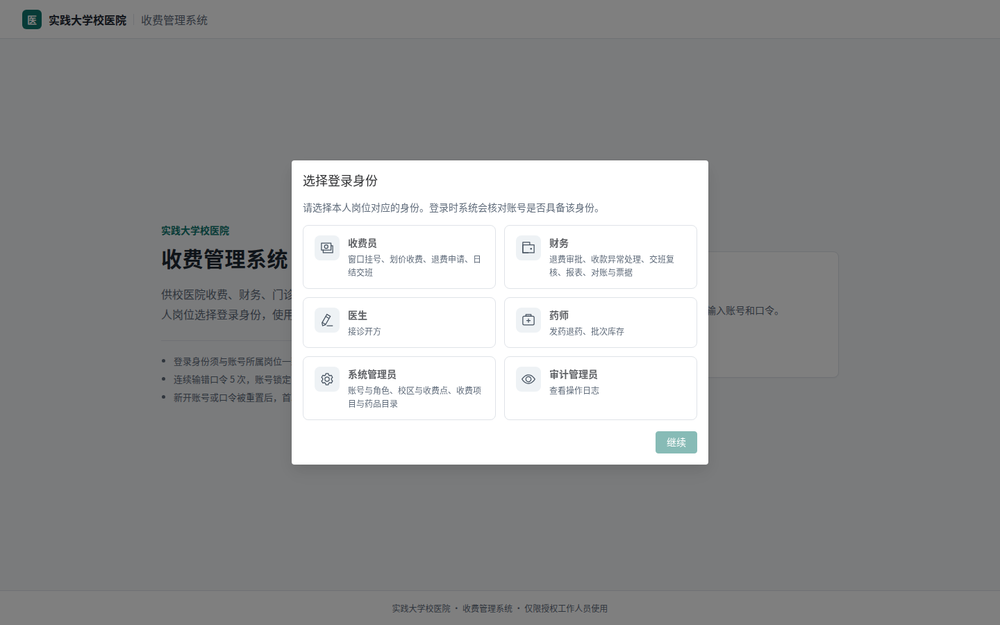
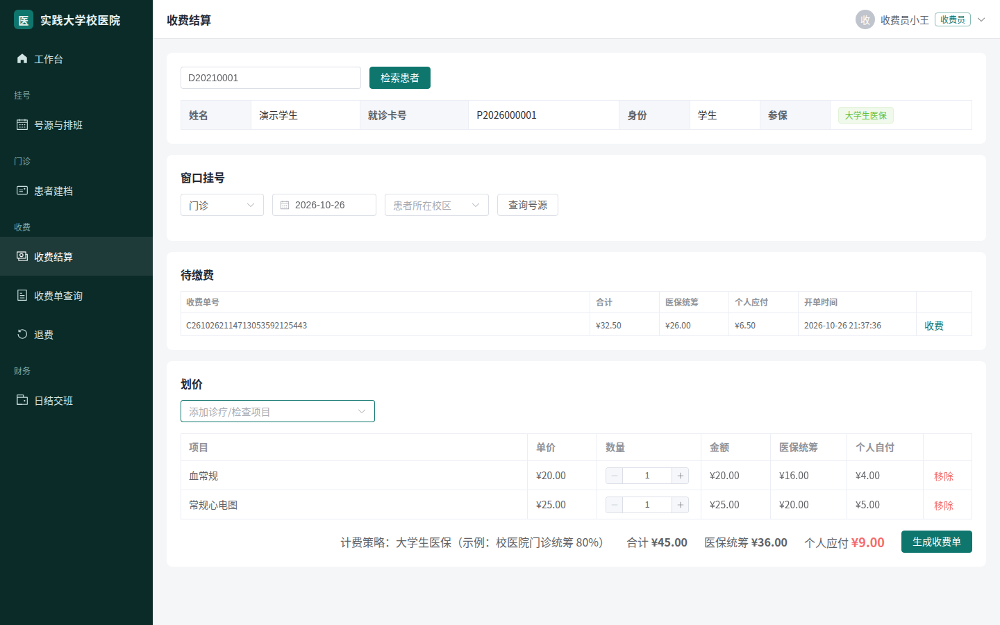
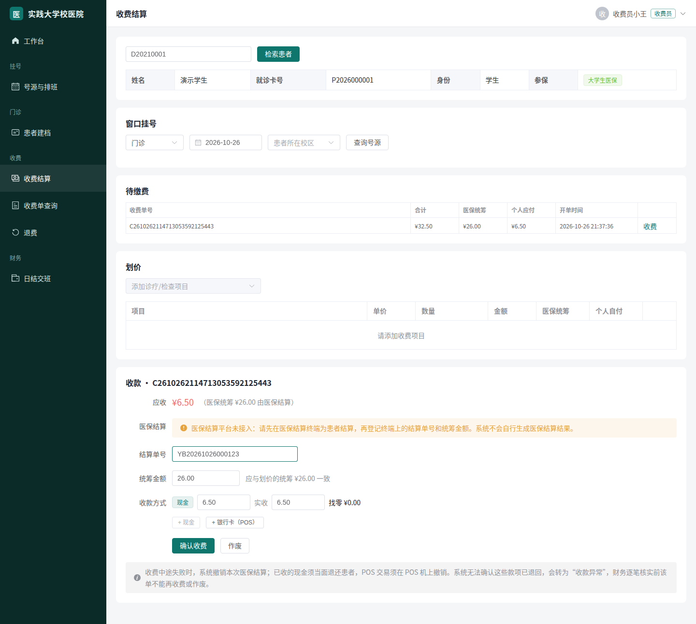
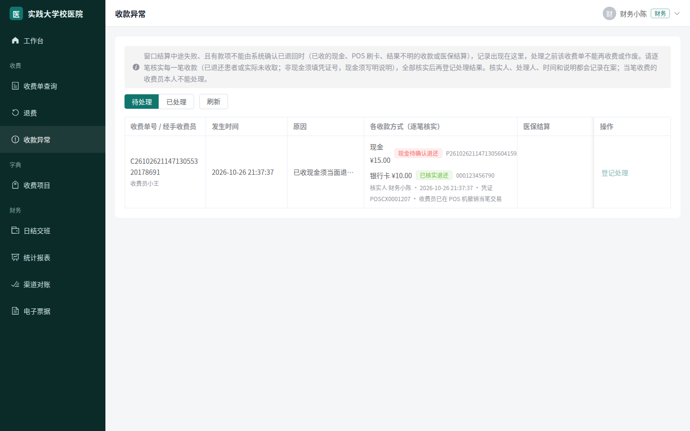
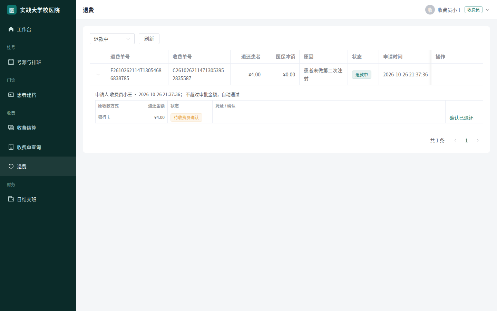
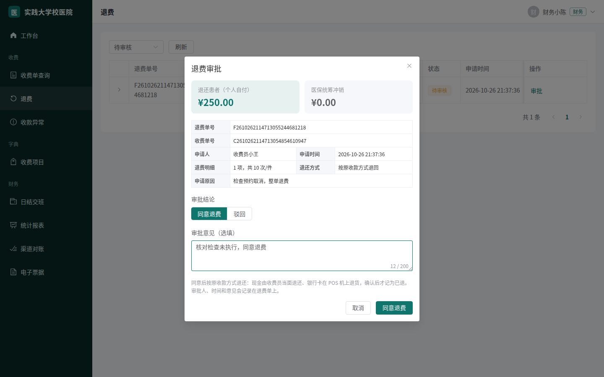
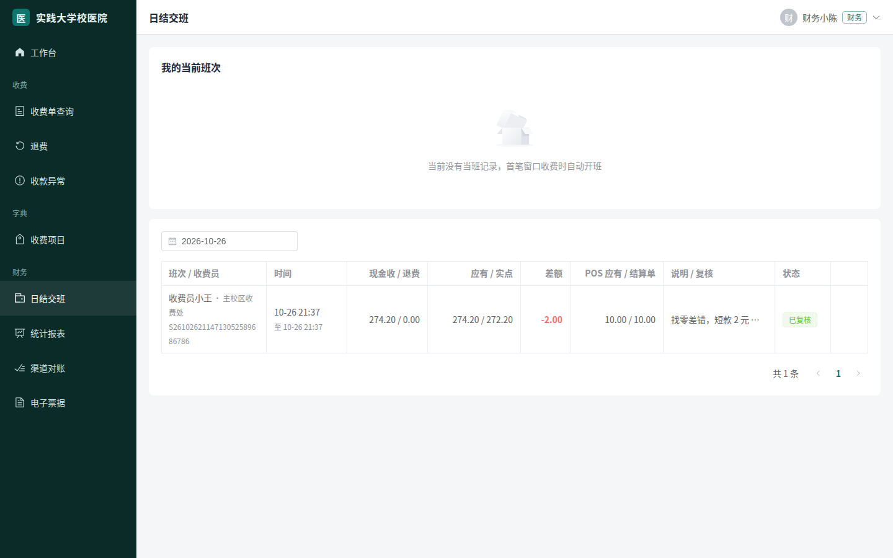
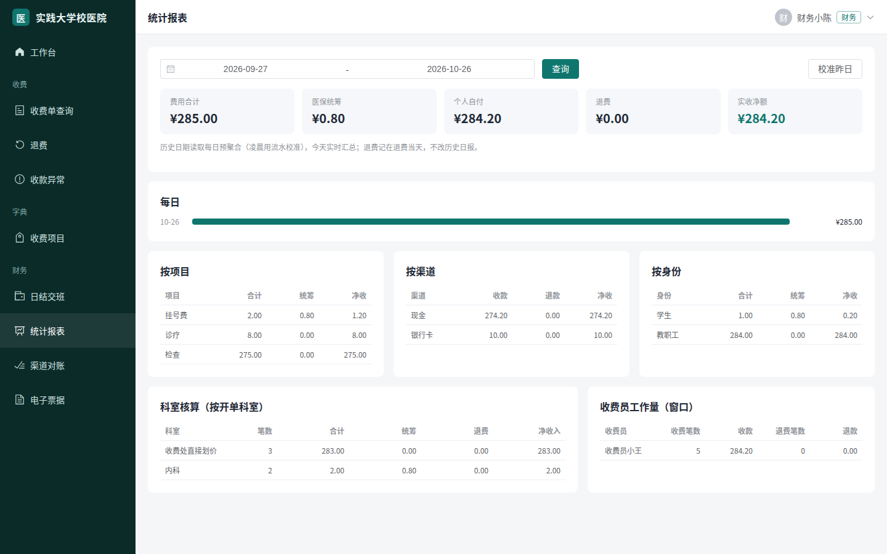

# 高校校医院收费管理系统

[](https://github.com/ryancamus12138-sketch/campus-clinic-his/actions/workflows/ci.yml)


[](LICENSE)

## 项目简介

面向国内高校校医院门诊窗口的收费管理系统。收费员在窗口完成挂号、划价和收费，财务人员处理退费审批、收款异常和交班复核；每一笔收款、退款都记录经办人和凭证，交班和报表由资金流水汇总。

系统不绑定具体学校：机构名称、校区、收费窗口、收费项目和报销比例都在配置或数据库中维护，默认的“实践大学校医院”是演示名称。系统聚焦收费业务，挂号、开方和药房功能作为收费单的来源和退费的约束，不是完整的医院信息系统（HIS）。

## 功能模块

| 模块 | 功能 |
| --- | --- |
| 登录与权限 | 先选择登录身份再登录，后端核对账号是否具备该身份；菜单和接口按账号的实际角色授权 |
| 收费 | 窗口挂号、划价、医保结算结果登记、现金与银行卡组合收款；同一收费单不会被重复收费 |
| 收款异常 | 收费中途失败、已收的现金或 POS 交易无法由系统确认已退回时锁定收费单，由财务逐笔核实后解除 |
| 退费 | 按明细申请，超过阈值的需审批（申请人不能自批），按原收款方式退还，现金和银行卡由收费员确认 |
| 交接班 | 按资金流水计算应有金额，核对实点现金和 POS 结算单，差额须说明，由他人复核 |
| 报表与票据 | 按项目、渠道、科室、收费员汇总；票据记录与人工开具票号登记 |
| 门诊与药房 | 患者建档、号源排班、接诊开方、凭收费单发药与退药、批次库存 |
| 系统管理 | 账号与角色、校区与收费点、收费项目与药品目录 |
| 操作审计 | 所有写操作记入独立日志库，由审计管理员查看 |

## 技术栈

- **后端**：Java 21、Spring Boot 4.1、Spring Security、MyBatis-Plus、Flyway
- **前端**：Vue 3、TypeScript、Element Plus、Pinia、Vite
- **数据**：MySQL 8.4、Redis 8
- **测试与部署**：JUnit 5、Testcontainers、ArchUnit、Playwright、Docker Compose、Nginx、GitHub Actions

后端采用模块化单体结构，收费、财务、药房、挂号、开方、患者、系统、审计等模块之间只通过公开接口调用。

## 界面展示

以下截图由截图脚本在开发环境中操作真实页面生成，数据为演示数据。

| 选择登录身份 | 划价 |
| --- | --- |
|  |  |

| 收费结算 | 收款异常处理 |
| --- | --- |
|  |  |

| 退费 | 退费审批 |
| --- | --- |
|  |  |

| 日结交班 | 统计报表 |
| --- | --- |
|  |  |

## 运行方式

需要安装 Docker 和 Docker Compose。

```bash
git clone https://github.com/ryancamus12138-sketch/campus-clinic-his.git
cd campus-clinic-his/deploy
cp .env.example .env
docker compose up -d --build
```

启动完成后访问 http://localhost 。这是开发与演示编排，只提供 HTTP 并加载演示数据；演示账号、生产部署（HTTPS、密钥、备份）见[部署手册](docs/deploy.md)，系统结构与数据模型见[设计文档](docs/design.md)。

推送到 `main`、`dev/**` 分支和每个 Pull Request 都由 GitHub Actions 运行后端单元测试与集成测试、前端代码检查与构建，以及 Nginx 镜像验证。本地运行后端测试需要 JDK 21、Maven 和 Docker（集成测试用 Testcontainers 启动 MySQL 和 Redis）：

```bash
cd backend && mvn -B verify
```

## 数据与接口

**数据库。** 系统使用 MySQL 存储业务数据，操作日志存放在单独的日志库中。表结构由 Flyway 迁移脚本建立和更新（`backend/clinic-server/src/main/resources/db/migration`），应用启动时自动执行。开发环境还会执行独立的演示数据脚本（`db/seed-dev`），写入演示账号、收费项目、药品和患者档案；这些都是合成数据，生产环境不加载。运行期间产生的收费、退费、交班等业务数据都保存在数据库中。

**外部系统。** 当前版本未接入医保结算、统一支付、校园一卡通、财政电子票据和药品追溯码平台。医保结算、POS 刷卡和电子票据由工作人员在外部终端或平台办理后，在系统中登记结果；校园卡和付款码收款不可用。测试代码中有这些平台的测试替身（Mock），只用于验证业务异常处理和接口约定，不进入生产构建，也不代表已与这些平台联调。

## 许可证

[MIT](LICENSE)
