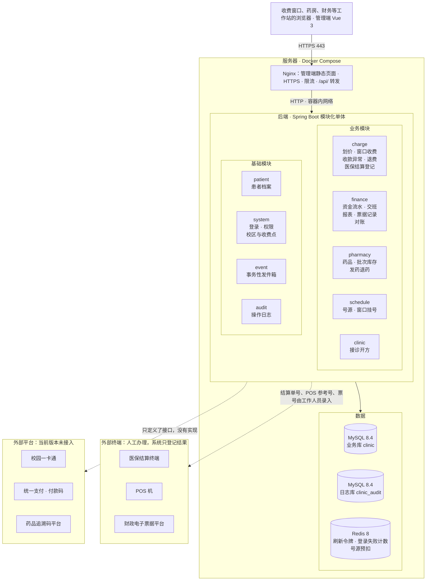
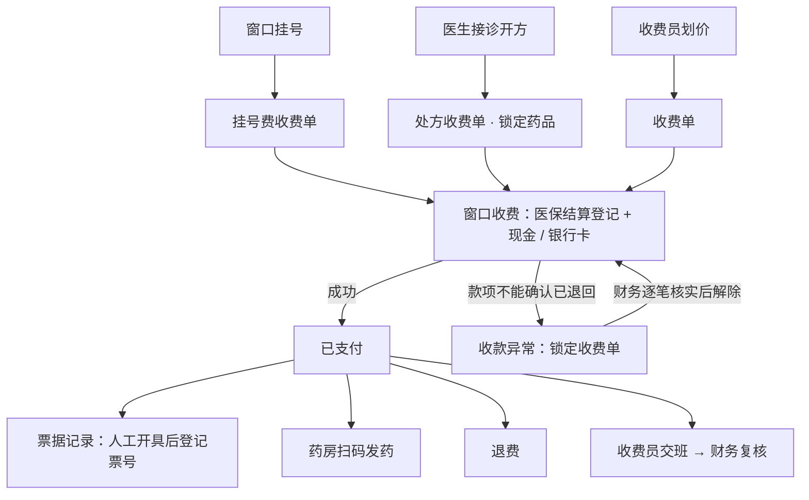
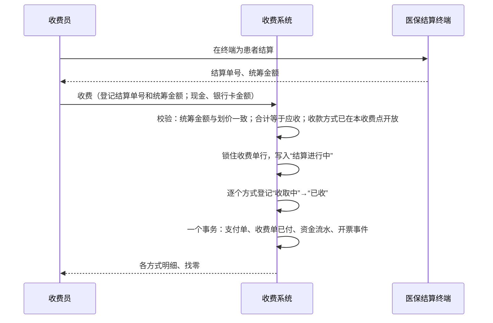
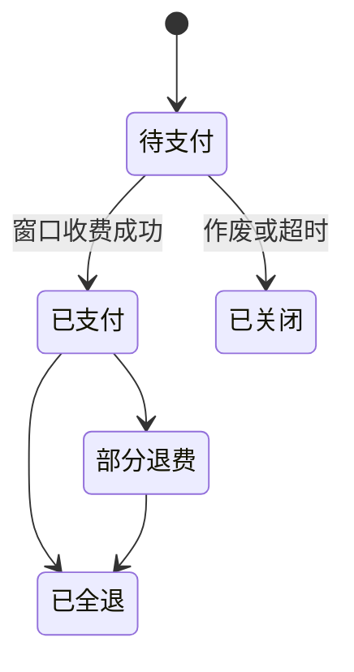
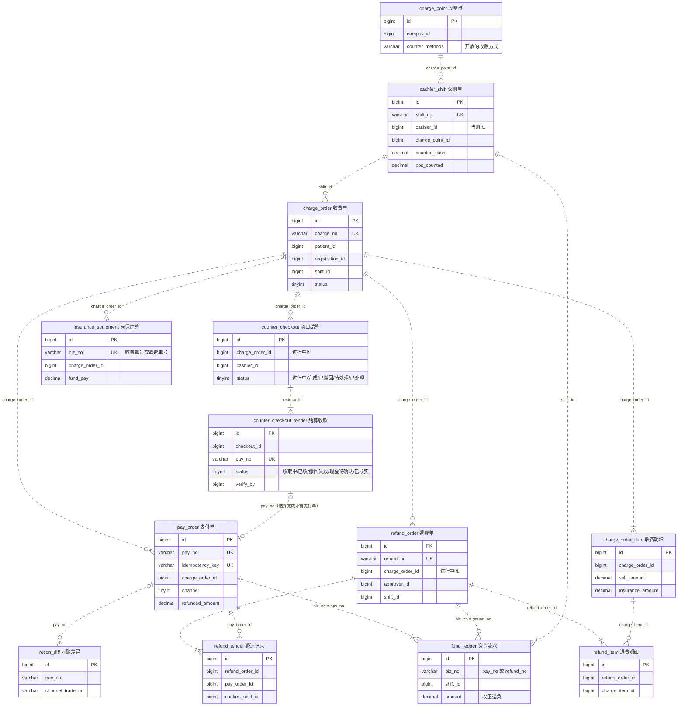

# 设计文档

本文说明系统的范围、结构、核心流程和数据模型。表结构以 `backend/clinic-server/src/main/resources/db/migration` 中的 Flyway 脚本为准，图中的模块、表和字段都能在代码或迁移脚本中找到。

## 1 范围

系统面向高校校医院的门诊收费窗口，使用者是收费员、财务、医生、药师、系统管理员和审计管理员。学生和教职工在窗口办理业务，不登录本系统。

| 功能 | 说明 |
| --- | --- |
| 窗口挂号 | 收费员为患者挂号，同时生成挂号费收费单；超时未缴费自动退号 |
| 接诊开方 | 医生为挂号患者开药品和诊疗项目，用于生成收费明细和锁定药品，不记录病历 |
| 划价 | 收费项目按版本维护价格；划价时按参保类型估算医保统筹与个人自付 |
| 窗口收费 | 登记医保结算结果，现金、银行卡（POS）组合收取个人自付 |
| 收款异常 | 收费中途失败、且有款项不能由系统确认已退回时锁定收费单，由财务逐笔核实后解除 |
| 退费 | 按明细和数量申请，超过阈值的需审批，按原收款方式退还 |
| 药房 | 药品目录、批次库存、发药退药、追溯码采集 |
| 财务 | 资金流水、日结交班与复核、统计报表、票据记录 |
| 系统 | 登录与权限、校区与收费点、账号与角色、操作日志 |

校区、收费窗口、收费项目、报销比例、退费审批阈值都在数据库或配置中维护，代码中不包含任何学校的制度。

## 2 系统结构

### 2.1 系统架构

- **Nginx** 是唯一对外开放的服务（80、443）：提供管理端静态文件和前端路由回落，把 `/api/` 转发给后端，并做限流和安全响应头。生产编排只提供 HTTPS，证书缺失时拒绝启动（见部署手册）。
- **后端** 是一个 Spring Boot 应用，分为 9 个模块，模块内按 controller → service → mapper 分层。模块之间只能调用对方 `api` 包中的接口，且不能形成循环依赖，由 ArchUnit 测试检查。
- **MySQL** 中有两个库：业务库 `clinic` 和操作日志库 `clinic_audit`。应用账号只有业务库的增删改查、日志库的查询和插入；表结构由单独的迁移账号在启动时更新。
- **Redis** 只存可丢失的状态：刷新令牌、退出登录的令牌黑名单、登录失败计数、号源余量的预扣缓存（以数据库为准）。
- **外部系统**：医保结算、POS 刷卡和财政票据由工作人员在外部终端或平台办理，系统只登记结果；校园卡、付款码和追溯码上传在代码中只定义了接口，没有实现，相应功能不可用。

### 2.2 模块

| 模块 | 职责 |
| --- | --- |
| charge | 收费项目、计费策略、划价、收费单、窗口收费、收款异常、退费、医保结算记录 |
| finance | 资金流水、交班与复核、报表、票据记录、渠道对账 |
| pharmacy | 药品目录、批次库存、开方锁定、发药退药、追溯码 |
| schedule | 号源、窗口挂号、超时退号 |
| clinic | 接诊开方 |
| patient | 患者档案、身份类别、参保类型 |
| system | 登录、账号与角色、校区与收费点、机构名称 |
| event | 事务性发件箱 |
| audit | 操作日志 |

## 3 业务流程

### 3.1 主流程

### 3.2 窗口收费

收费中途任一步失败时，系统撤销本次医保结算登记，并按收款方式处理已收的款项：

| 收款方式 | 处理 |
| --- | --- |
| 现金 | 系统不能确认现金是否已当面退还患者，记为“现金待确认退还”，转为收款异常 |
| 银行卡（POS） | POS 机是独立终端，系统撤不了，记为“撤回失败”，转为收款异常 |
| 医保结算撤销失败、结果不明 | 转为收款异常 |

只有全部款项都能确认已撤回（例如尚未收取任何款项）时，收费单才直接恢复为待收费。

### 3.3 收款异常

以下情况转为收款异常并锁定收费单：已收取的款项不能由系统确认已退回（现金、银行卡）、医保结算未能撤销、收款途中程序中断（进行中超过 5 分钟）。锁定期间，同一收费单的重收、重试和作废都被拒绝。

处理由经办收费员以外的财务人员完成（权限 `charge:exception:handle`）：

1. **逐笔核实**：对每一笔可能已收取的款项，核实为“已退还患者”或“实际未收取”。非现金须填写凭证号（如 POS 撤销参考号），现金须写明说明（如“当面退还，患者签字”）。系统记录核实人和时间，每笔只能核实一次。
2. **登记处理结果**：全部核实、医保结算已撤销后，登记处理说明，收费单解除锁定，患者重新缴费。

核实只记录钱的去向，不产生支付单和资金流水，因此不影响交班和报表。

### 3.4 退费

1. **申请**：按明细预占退费数量（已退 + 已发药 + 本次 ≤ 数量）。已发的药先退药；医生接诊后挂号费不退。
2. **审批**：个人自付不超过阈值（默认 200 元）的自动通过，超过的由财务审批。系统记录审批人、时间和意见；驳回必须写理由；申请人不能审批本人的退费。
3. **执行**：
   - 有医保结算的，收费员在医保结算终端撤销原结算、按剩余项目重新结算后登记；
   - 自付退款额按收款的逆序分配到各笔支付；
   - 现金和银行卡为“待收费员确认”，收费员当面退还现金或在 POS 机上退货后确认，银行卡须录入退货参考号。系统记录确认人、时间和所在班次。
4. **完成**：全部退还后，在一个事务中累加已退金额、写负数资金流水、释放药品锁定、生成冲红票据记录。

### 3.5 交班与复核

| 环节 | 做法 |
| --- | --- |
| 开班 | 收费员第一次收费时自动开班，班次记录所在收费点 |
| 交班 | 由本班资金流水算出应有现金（现金收 − 现金退）和 POS 应有金额（银行卡收 − 银行卡退）。收费员录入实点现金；有银行卡收款或退款的，录入 POS 机结算单金额。任一不一致须填写差额说明 |
| 复核 | 财务复核交班单，记录复核人、时间和意见；收费员不能复核本人的班次 |
| 报表 | 按日期、项目类型、收款方式、患者身份、科室、收费员汇总；每日凌晨用流水重算前两天的汇总 |

## 4 关键设计

### 4.1 收费单状态

所有状态转换都在服务层通过条件更新完成（`UPDATE … WHERE status = 原状态`），同一转换只会成功一次。收款异常不改变收费单状态，而是由一条“待处理”的结算记录阻止收费和作废。

### 4.2 防止重复收费

- 收费、作废、超时关闭之前，先锁住收费单行（`SELECT … FOR UPDATE`），同一收费单的这些操作只能依次执行。
- 每次收费携带客户端生成的幂等键，网络重试或重复点击返回第一次的结果。
- “同一收费单只有一条进行中的结算”由唯一索引保证，作为第二道防线。
- 收费失败后，只要还有款项不能确认已退回，收费单就保持锁定，直到财务核实。
- 应收金额由服务端按收费项目价格计算，客户端只提交项目编码和数量。

### 4.3 资金流水

资金流水只追加：收费记正数，退费记负数。退费记在退费当天，记入确认人当时的班次。交班和报表都由流水汇总，已形成的数据不会因后续退费而改变。

### 4.4 号源与库存

- **号源**：先用 Redis 原子预扣，再由数据库条件更新（`remaining > 0`）兜底；同一患者同一号源只有一条有效挂号。
- **库存**：开方时锁定库存（先到期的批次先出），发药时转为实扣，退药时回补；按批次 ID 升序加锁，避免死锁。

### 4.5 开票等后续处理

付清、退费后的开票事件与业务数据在同一事务中写入发件箱，由投递器异步处理，失败时退避重试，消费方按事件去重。当前版本生成“待开具”票据记录，由财务人工开具后登记票号。

### 4.6 登录与权限

1. 未登录访问任何页面时进入登录页，先选择登录身份。可选身份取自 `sys_role` 中启用的角色，保存在地址参数 `role` 中，刷新后保持。
2. 登录时提交所选身份。口令校验通过后，后端核对账号是否具备该身份，不具备时返回错误码 10022，不签发令牌。
3. 菜单和接口权限取自账号在数据库中的实际角色，所选身份不授予任何权限。每个接口通过 `@PreAuthorize` 校验权限。

## 5 数据模型

### 5.1 约定

| 约定 | 做法 |
| --- | --- |
| 主键 | `BIGINT` 雪花 ID；校区、收费点、角色等参考数据用固定的小整数 |
| 金额 | `DECIMAL(12,2)` 加 CHECK 约束，代码中用 `Money` 值对象 |
| 敏感字段 | 证件号、手机号加密存储，另存哈希列用于检索 |
| 表间关系 | 不建 FOREIGN KEY，关联列只建索引，引用是否存在由应用层在同一事务中校验（逻辑关联）。原因是外键会让子表插入对父表加共享锁，与号源、批次、收费单上的行锁冲突 |
| 一致性规则 | 由唯一约束保证（见 5.4），并发下不依赖应用层判断 |
| 资金与库存 | 不删除、不覆盖，只追加流水或修改状态 |

### 5.2 核心表

| 表 | 作用 |
| --- | --- |
| `sys_campus` / `charge_point` | 校区、收费窗口及其开放的收款方式 |
| `schedule_slot` / `registration` | 号源、挂号 |
| `price_item` | 收费项目的价格版本 |
| `charge_order` / `charge_order_item` | 收费单与明细（单价、报销比例快照） |
| `counter_checkout` / `counter_checkout_tender` | 一次窗口收费及每种收款方式的收取、撤回、核实记录 |
| `pay_order` | 支付单，每种收款方式一笔 |
| `insurance_settlement` | 医保结算记录（登记人、撤销人） |
| `refund_order` / `refund_item` / `refund_tender` | 退费单（申请人、审批人、审批意见）、明细、按收款方式的退还记录 |
| `fund_ledger` | 资金流水 |
| `cashier_shift` | 交班单（实点现金、POS 结算单金额、差额说明、复核） |
| `recon_diff` | 渠道对账差异（需接入支付渠道后才会产生） |
| `e_invoice` | 票据记录 |
| `outbox_message` | 发件箱 |

### 5.3 核心实体关系

下图覆盖收费、支付、退费、交班和对账的核心表，只列出主键、业务唯一键和关联列。**图中所有连线都是逻辑关联**（虚线）：关联列有索引，但数据库没有外键约束。连线上的列名即关联依据；资金流水和对账差异按业务单号（`pay_no`、`refund_no`）关联，而不是按 ID。

### 5.4 由数据库约束保证的规则

| 规则 | 约束 |
| --- | --- |
| 同一收费单同时只有一次进行中的窗口结算 | `counter_checkout.uk_one_active_checkout`（进行中时的生成列） |
| 同一收费单同时只有一张进行中的退费单 | `refund_order.uk_one_active_refund` |
| 同一幂等键只产生一笔支付单、一张退费单 | `pay_order.uk_idem`、`refund_order.uk_idem` |
| 同一笔支付在同一张退费单中只退一次 | `refund_tender.uk_refund_pay` |
| 同一业务单号、项目类型、日期只记一条资金流水 | `fund_ledger.uk_biz` |
| 一个收费员同时只有一个当班班次 | `cashier_shift.uk_one_open_shift` |
| 同一条开方明细或挂号只对应一条有效的收费明细 | `charge_order_item.uk_active_ref` |
| 金额等字段的取值范围（如收款金额大于 0） | 各表的 CHECK 约束 |

### 5.5 迁移

迁移脚本使用 Flyway 的版本化迁移（Versioned migration）命名，例如 `V22__cash_return_unconfirmed.sql`：

| 部分 | 含义 |
| --- | --- |
| `V` | 版本化迁移，每个版本只执行一次 |
| `22` | 版本号，按数值决定执行顺序（V2 在 V10 之前；代码托管页面按文字排序时显示顺序会不同） |
| `__` 之后 | 变更描述，英文小写加下划线 |

- `db/migration`（V1–V23）在所有环境执行；`db/seed-dev`（V1000–V1005）是开发环境演示数据，只在开发编排（`PROFILE=dev`）和测试中执行。
- 迁移执行后，文件名和内容都不能再修改：Flyway 在每次启动时校验已执行脚本的校验值（checksum），不一致时拒绝启动。变更一律新增版本，编号接着最大的版本往后排，如 `V23__add_xxx.sql`、`V24__adjust_xxx.sql`，不使用日期式版本号，也不改写已有编号。
- 每个脚本的 SHA-256 登记在 `backend/clinic-server/src/test/resources/migration-lock.txt`，由 `MigrationLockTest` 在每次构建时检查：已登记的脚本被修改、删除或改名时构建失败；新增脚本须在该文件末尾登记一行。
- **基线**：首次部署之前，V2、V6、V13、V20、V1001、V1002 被改写过一次，只涉及示例数据和注释；执行到 V20 之后，改写前后的数据相同。V1–V22、V1000–V1005 的当前内容即为基线，此后不再有例外。基线之前建立的开发数据库启动时会报 checksum mismatch，按部署手册中的一次性运维步骤处理；应用启动时不做任何自动对齐。

迁移是按开发顺序累积的，早期版本加入的部分功能后来被移出收费系统范围，由后续版本删除；早期脚本注释中的阶段编号和“设计文档第 N 章”指当时的文档结构。各版本的作用：

| 版本 | 作用 |
| --- | --- |
| V1 | 初始表结构：账号与权限、患者、号源与挂号、收费单、支付、退费、药品与库存、财务、发件箱 |
| V2 | 参考数据：示例校区、科室、角色与权限 |
| V3–V5 | 收费与支付、药房库存与退费、交班与报表等的补充字段和约束 |
| V6 | 证件类型、敏感字段加密列、独立的操作日志库 |
| V7 | 账号安全：临时口令强制修改、账号管理权限（其中的双因素认证由 V18 删除） |
| V8 | 药品与收费项目的医保编码、调价版本、药库维护 |
| V9、V10 | 门诊病历、签到叫号（超出收费范围，分别由 V12、V11 删除） |
| V11、V12 | 删除签到叫号；删除病历、诊断、过敏史、盘点报损，保留医保编码与调价版本 |
| V13 | 医保结算记录 |
| V14 | 按开单科室核算 |
| V15 | 窗口组合收款、按收款方式原路退费 |
| V16 | 删除未使用的转诊单表 |
| V17 | 窗口结算记录：先锁单再收款，撤不回的款项转财务处理 |
| V18 | 删除双因素认证、口令定期到期和审计链，操作日志保留独立库与只增不改 |
| V19 | 收款异常锁定收费单、医保登记人与撤销人、退款确认人与班次 |
| V20 | 示例校区改为中性名称；删除患者账号；收费点与开放的收款方式 |
| V21 | 收款异常逐笔核实、退费审批留痕、交班核对 POS 结算单、岗位分离 |
| V22 | 收款失败时的现金记为“待确认退还” |
| V23 | 同步 V18 遗留的权限名称和注释 |

资金流水 `fund_ledger`、库存流水 `stock_flow` 和 `operate_log` 按时间分区，V1 建立的分区到 2026 年底，之后的数据进入 `pmax` 分区：功能不受影响，但查询不能再按年份裁剪分区。正式运行时应在每年年底前用新增迁移（`ALTER TABLE … REORGANIZE PARTITION pmax`）补充下一年度的分区。

## 6 安全

| 措施 | 做法 |
| --- | --- |
| 权限 | 每个接口按权限码校验；用户身份只从登录令牌中读取 |
| 口令 | BCrypt 存储；至少 10 位并包含三类字符；临时口令首次登录须修改；连续输错 5 次锁定 15 分钟 |
| 岗位分离 | 退费申请人不能审批本人的退费；经办收费员不能处理本人的收款异常；收费员不能复核本人的班次；系统管理员和审计管理员不能是同一账号 |
| 敏感数据 | 证件号、手机号加密存储，页面默认打码 |
| 操作日志 | 所有写操作和被拒绝的请求都记入独立日志库，业务数据库账号只能写入、不能修改 |
| 数据库账号 | 应用使用最小权限账号，不能建表或删表；表结构由单独的迁移账号在启动时更新 |
| 传输 | 生产环境只提供 HTTPS，证书缺失时 Nginx 拒绝启动；后端、MySQL、Redis 不映射到宿主机 |

## 7 外部系统

| 外部系统 | 当前版本 |
| --- | --- |
| 医保结算 | 未接入。收费员在医保结算终端办理后，在系统中登记结算单号和统筹金额；退费时在终端撤销重结后登记 |
| 银行卡（POS） | POS 机为独立终端，收费员录入参考号；撤销、退货在 POS 机上办理 |
| 财政电子票据 | 未接入。系统生成待开具记录，财务在票据平台开具后登记票号 |
| 校园一卡通、统一支付（付款码） | 未接入，收费界面不提供这两种收款方式 |
| 药品追溯码平台 | 未接入。追溯码在发药时采集并保存在系统中，不上传 |

代码中为上述平台定义了接口（`InsuranceGateway`、`CampusCardGateway`、`PayChannelClient`、`FiscalInvoiceClient`、`TraceCodeUploader`），正式代码中没有任何实现。

测试代码（`src/test`）中有这些接口的测试替身（`MockInsuranceGateway`、`MockCampusCardGateway`、`MockPayGateway` / `MockPayChannelClient`、`MockFiscalInvoiceClient`、`MockTraceCodeUploader`），由测试配置 `TestDoubles` 注册，用于验证超时、失败、结果未知、重复请求、撤销和幂等时的业务处理，并运行接口约定（契约）测试。它们不进入生产构建，也不代表与外部平台完成联调。以下检查保证这一点：

| 检查 | 内容 |
| --- | --- |
| `NoSimulatedPlatformInProductionTest`（每次构建） | 正式代码中没有 Mock / Fake / Stub 类或 mock 包；上述接口在正式代码中没有未登记的实现 |
| Security 工作流的生产编排检查 | 生产镜像的 jar 中没有 mock 包和 Mock 类；后端以 `prod` Profile 运行，没有执行开发环境初始化 |

## 8 验证

自动化测试中，验证关键业务指标的用例会输出以 `[Mn]` 开头的结果行，由 CI 汇总到运行摘要中。编号对应如下（编号不连续，是因为部分指标随功能删除）：

| 编号 | 验证内容 | 位置 |
| --- | --- | --- |
| M4 | 10 万张随机收费单分多次退完，金额分摊与合计无误差 | `FeeCalculatorTest` |
| M5 | 同一收费单并发退费，退款合计不超过实收 | `RefundIntegrationTest` |
| M6 | 锁定、发药、退药、释放混合并发，库存无超扣、无死锁 | `StockConcurrencyTest` |
| M7、M8 | 日常收费 10 倍峰值；150 万条资金流水的月报 | Perf 工作流（手动运行，见 `perf/README.md`） |
| M9 | 渠道对账识别注入的长款、短款、金额不符 | `FinanceIntegrationTest` |
| M10 | 未登录访问、角色越权、水平越权、令牌篡改、注入 | `SecurityIntegrationTest` |
| M11 | 各业务模块的行覆盖率（核心模块不低于 80%） | CI 工作流 |
| M13 | 票据平台失败重试后每张收费单只开一张票 | `FinanceIntegrationTest` |
| M14 | 已交班金额与历史日报不因后续退费改变 | `FinanceIntegrationTest` |
| M15 | 操作日志完整，业务账号不能修改 | `AuditIntegrationTest` |
| M16 | 证件号、手机号加密存储，日志中不出现明文 | `PatientSecurityIntegrationTest` |
| M17 | 临时口令强制修改、账号管理约束、口令策略 | `AccountSecurityIntegrationTest` |
| M18 | 生产编排：只开放 80/443、HTTPS、密钥文件、首次登录 | Security 工作流 |
| M19 | 按开单科室核算与收费员工作量 | `FinanceIntegrationTest` |
| M22 | 调价按生效时间切换，可撤销未生效的调价 | `PriceDictIntegrationTest` |
| M25 | 医保结算失败、撤销失败、结果未知时的处理 | `InsuranceSettlementIntegrationTest` |
| M26 | 多个窗口同时收同一张单，只收一次 | `CounterCheckoutIntegrationTest`、`CounterRegistrationIntegrationTest` |

外部平台相关的指标（M9、M13、M25）使用测试替身，只验证系统一侧的处理，不代表与外部平台联调。
